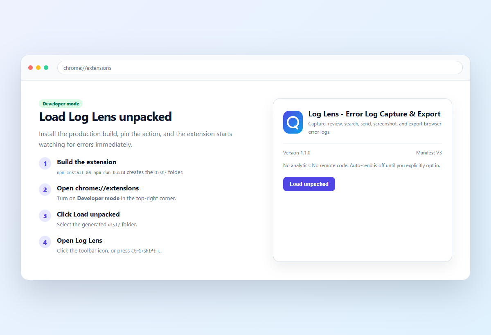
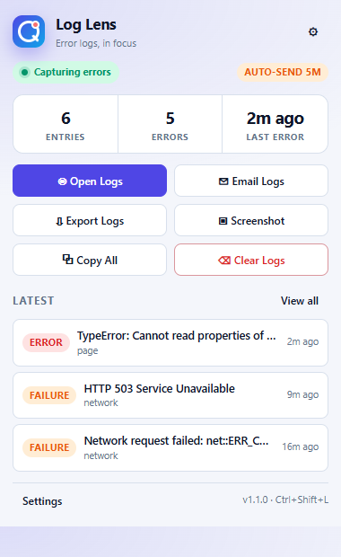
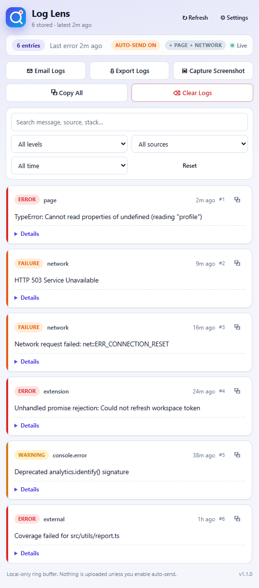
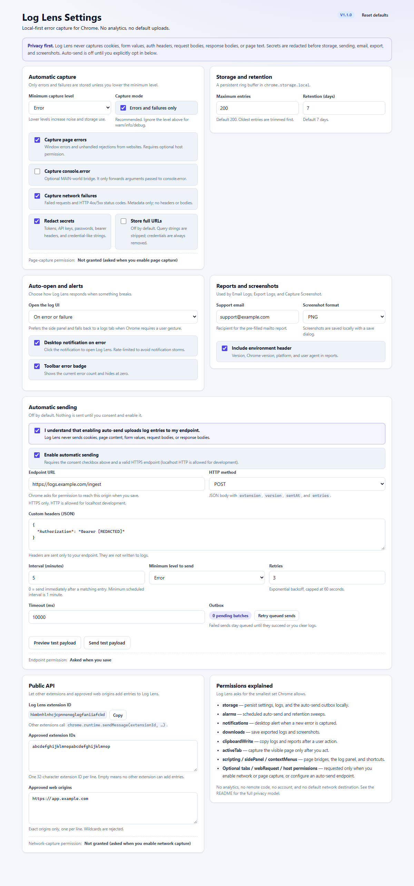
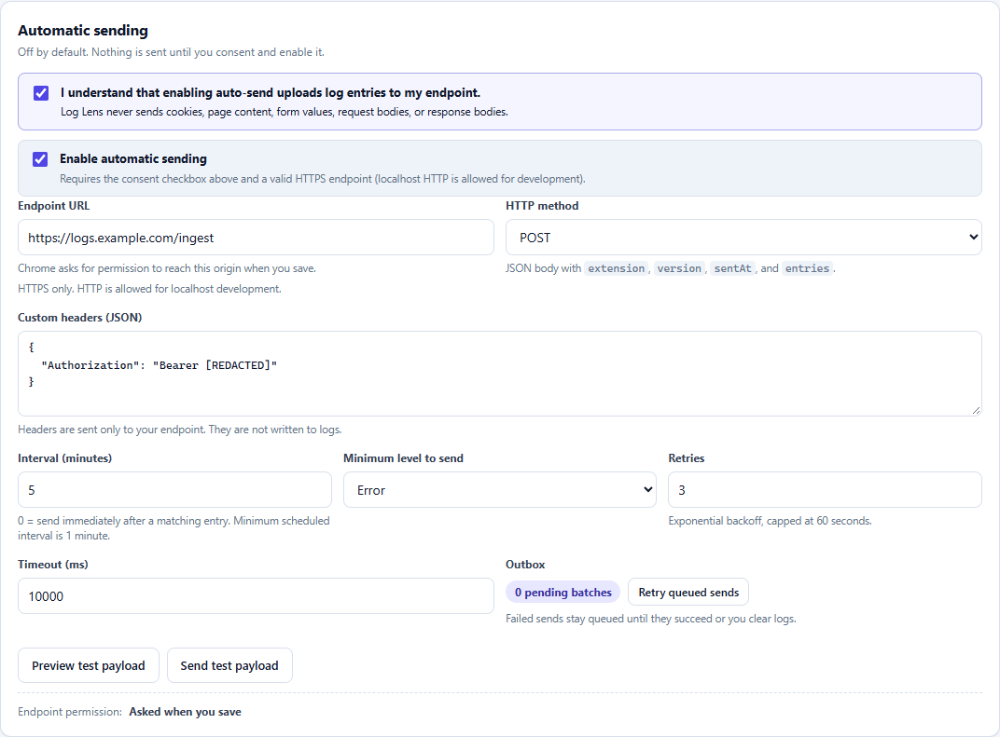
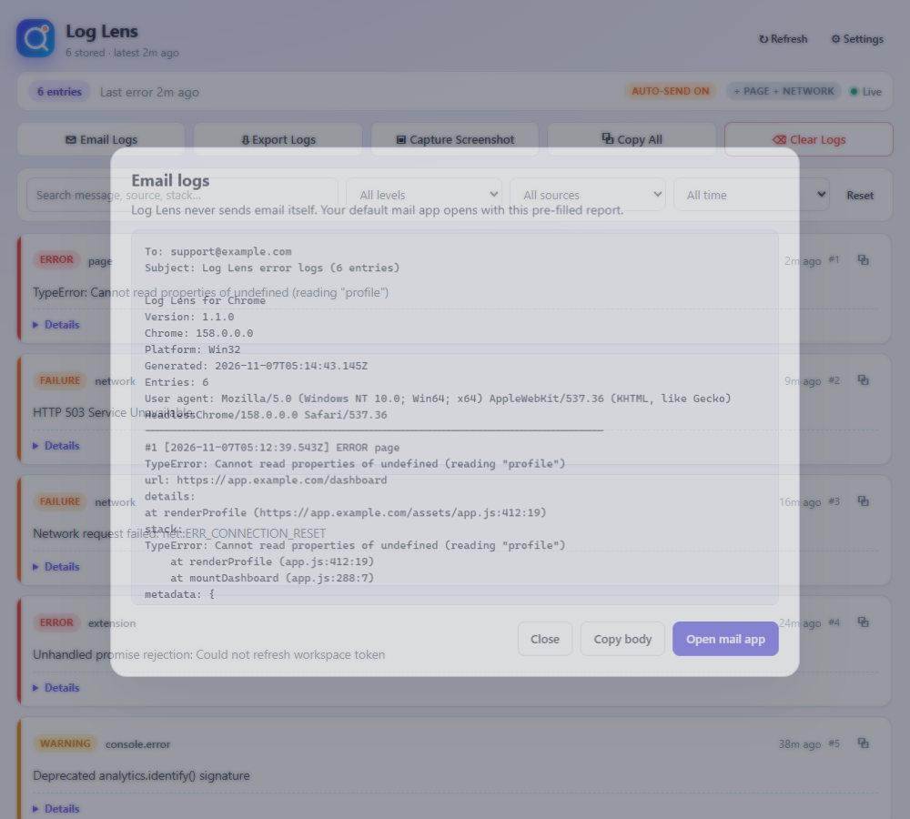
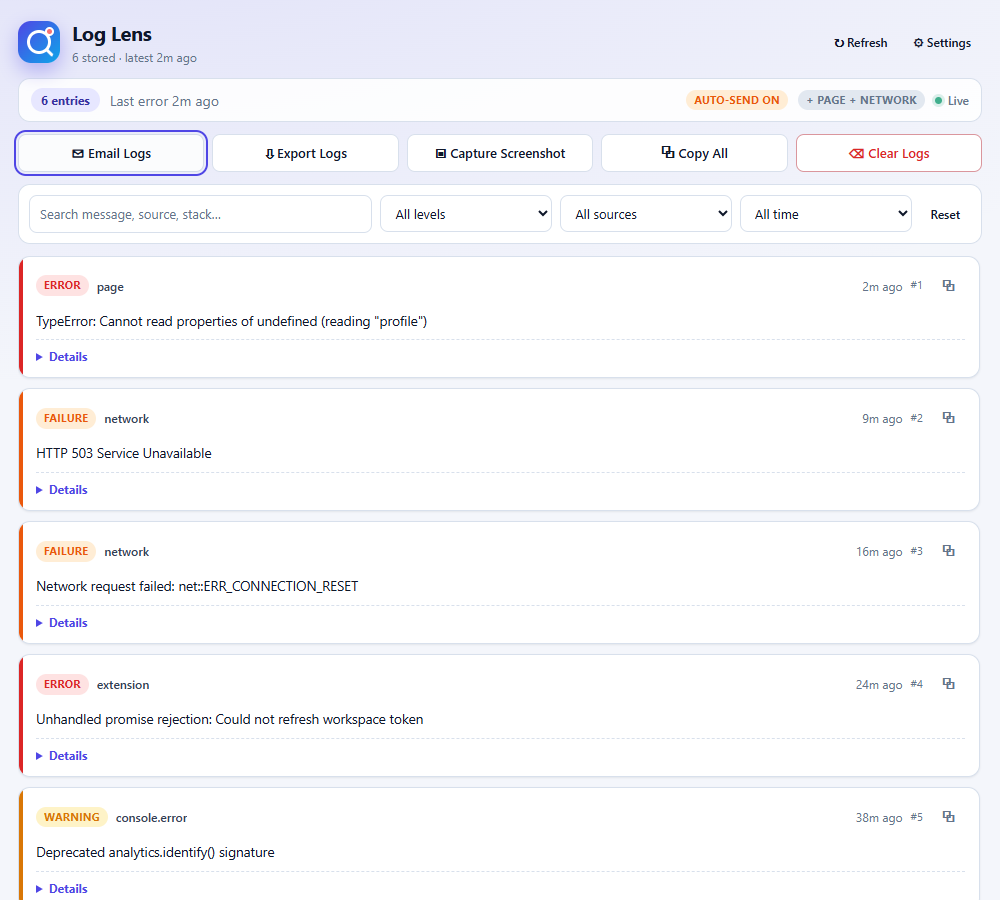
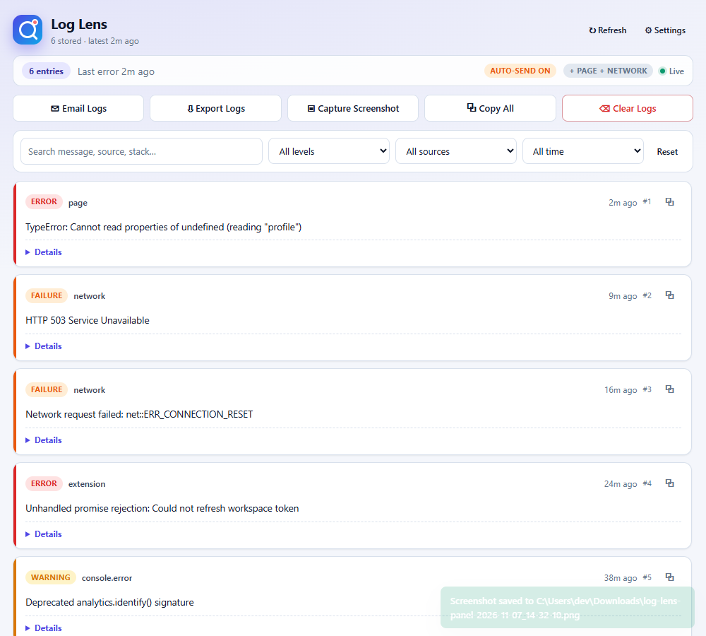

# Log Lens for Chrome

**Capture, review, send, screenshot, and export browser error logs — locally and privately.**

Log Lens is a standalone Chrome Manifest V3 extension that watches for extension errors,
unhandled rejections, optional page errors, and optional network failures. It keeps a
persistent ring buffer in `chrome.storage.local`, gives you a fast searchable viewer, and
only sends data when **you** explicitly configure and enable an endpoint.

- **Local-first:** no account, no cloud, no analytics, no remote code.
- **Quiet by default:** only `error` and `failure` entries are captured.
- **Private by design:** cookies, form values, auth headers, request/response bodies, and
  page text are never captured. Secrets are redacted before storage, sending, email,
  export, and screenshots.
- **Reusable:** other extensions and approved web origins can feed Log Lens through a
  small, validated public API.

Version **1.1.0** · Manifest V3 · TypeScript · Chrome 116+

---

## Contents

- [Screenshots](#screenshots)
- [Install](#install)
- [Quick start](#quick-start)
- [Automatic capture](#automatic-capture)
- [Automatic opening](#automatic-opening)
- [Viewing and filtering logs](#viewing-and-filtering-logs)
- [Automatic sending](#automatic-sending)
- [Email logs](#email-logs)
- [Export logs](#export-logs)
- [Screenshot capture](#screenshot-capture)
- [Clear logs](#clear-logs)
- [Public API](#public-api)
- [Settings reference](#settings-reference)
- [Permissions](#permissions)
- [Privacy](#privacy)
- [Troubleshooting](#troubleshooting)
- [Development](#development)
- [Architecture](#architecture)
- [Changelog](#changelog)
- [License](#license)

---

## Screenshots

### Load the unpacked build



### Popup summary



### Side-panel log viewer with search and filters



### Options page



### Auto-send consent, endpoint, retries, and preview



### Email report preview



### Export result



### Screenshot result



---

## Install

### Requirements

- Google Chrome **116 or newer** (the extension uses `chrome.sidePanel` and MAIN-world
  content scripts).
- Node.js **20.19 or newer** to build from source.

### Build and load unpacked

```bash
npm install
npm run build
```

The build creates a complete, loadable extension in `dist/`.

1. Open `chrome://extensions`.
2. Turn on **Developer mode** (top-right).
3. Click **Load unpacked**.
4. Select the **`dist/`** folder from this project.
5. Pin **Log Lens** to the toolbar.

The extension starts capturing immediately. It needs no account and has no default
network destination.

### Chrome Web Store

To publish, run:

```bash
npm run zip
```

This verifies the build and writes `log-lens-chrome-1.1.0.zip`. Upload that ZIP in the
Chrome Web Store developer dashboard. The ZIP contains only `dist/` output (no source
maps, no tests, no analytics).

### Where to find the extension ID

Open **Log Lens → Settings → Public API**. The page shows the current extension ID and a
copy button. Other extensions need this ID to send entries. For unpacked installations the
ID is derived from the folder path, so it stays stable unless you move the folder.

---

## Quick start

1. Click the toolbar icon to see the popup summary.
2. Click **Open Logs** to use the side panel, or press **`Ctrl+Shift+L`**
   (**`Command+Shift+L`** on macOS).
3. Trigger an error in any extension or, after enabling page capture, in a web page.
4. Search, filter, expand, copy, email, export, or screenshot the result.

By default only `error` and `failure` levels are stored. Nothing is sent anywhere.

---

## Automatic capture

Log Lens registers its listeners when the service worker starts, so Chrome can wake it for
new errors.

### Extension errors (always on)

The service worker captures:

- `self.addEventListener('error', …)`
- `self.addEventListener('unhandledrejection', …)`
- errors thrown by Log Lens background tasks (recorded as `failure`)

These entries use `source: "extension"`.

### Page errors (opt-in)

Turn on **Capture page errors** in Settings. Chrome then asks for the optional
`http://*/*` and `https://*/*` host permissions. If you grant them, Log Lens registers two
dynamic content scripts:

- A **MAIN-world** bridge that listens for `window.error` and
  `window.unhandledrejection`.
- An **isolated-world** content script that validates the bridge payload and forwards it
  to the service worker.

The bridge never reads page text, form values, or storage. It forwards only the browser's
error message, stack, and location. Turning the setting off unregisters the scripts. You can
also revoke the host permission in Chrome at any time.

### Console errors (opt-in)

Turn on **Capture console.error**. A separate MAIN-world bridge patches `console.error`,
preserves the original behavior, and forwards the arguments you passed. This is off by
default because console calls can contain arbitrary data.

### Network failures (opt-in)

Turn on **Capture network failures**. Chrome asks for the optional `webRequest` permission
plus host permissions. Log Lens observes:

- `chrome.webRequest.onErrorOccurred`
- `chrome.webRequest.onCompleted` for HTTP status **400 and above**

Only metadata is captured: sanitized URL, method, resource type, status code/error, time,
tab ID, and (when available) tab title. Request bodies, response bodies, cookies, and
headers are **never** read.

### Manual and external entries

Anything can add an entry through the public API (see [Public API](#public-api)) or through
the internal `LOG_LENS/ADD` message. The store applies the same validation, redaction, ring
buffer, deduplication, and retention rules.

### Ring buffer behavior

- Default maximum: **200 entries** (configurable 10–2,000).
- Default retention: **7 days** (configurable 1–365).
- Newest entries are kept; oldest entries are trimmed first.
- Identical consecutive entries within 3 seconds are coalesced and show an `×N` counter.
- If `chrome.storage.local` reports a quota error, Log Lens halves the buffer and retries,
  then falls back to an in-memory buffer for the session rather than dropping capture.

---

## Automatic opening

Choose how the viewer opens when something is captured:

| Mode | Behavior |
| --- | --- |
| `never` | Never open automatically. The badge and notifications still work. |
| `on-error` | Open for `error` and `failure` entries. **Default.** |
| `always` | Open for every captured entry, including warn/info/debug. |

The opening chain is:

1. Try `chrome.sidePanel.open({ tabId })`.
2. If Chrome requires a user gesture and the call fails, open `logs.html` in a tab.
3. If a logs tab already exists, focus it instead of creating duplicates.
4. A short cooldown (5 seconds) makes a burst of errors open the UI once.

Log Lens also shows a rate-limited desktop notification for new `error` entries. Clicking
the notification or its **Open Logs** button opens the viewer.

The toolbar badge shows the current error + failure count (`99+` above 99) and hides at
zero. You can turn the badge off in Settings.

The **`open-logs`** command is bound to `Ctrl+Shift+L` / `Command+Shift+L` and can be
changed at `chrome://extensions/shortcuts`.

The context menu adds **Open Log Lens** and **Capture Page Screenshot to Log Lens**.

---

## Viewing and filtering logs

The popup gives you:

- capture status, entry count, error count, and last error time
- the latest three entries
- Open Logs, Email, Export, Screenshot, Copy All, Clear, and Settings

The side panel and `logs.html` provide the full viewer:

- live updates through `chrome.storage.onChanged`
- free-text search across message, details, stack, source, URL, and metadata
- level filter (error, failure, warning, info, debug)
- source filter (page, network, extension, console.error, external, custom)
- time range filter (last hour, last 24 hours, last 7 days, all time)
- expandable details, stack, URL, and metadata
- per-entry copy and Copy All
- responsive layout for narrow side panels
- light/dark themes through `prefers-color-scheme`

All log text is rendered with DOM text nodes, never with untrusted HTML.

---

## Automatic sending

**Auto-send is disabled by default. Log Lens never sends anything until you check the
consent box, enable the feature, configure an endpoint, and save.**

### Consent and endpoint rules

- The consent checkbox is required before the enable toggle works.
- The endpoint must be **HTTPS**, or HTTP on `localhost` / `127.0.0.1` for development.
- Chrome asks for permission to reach the endpoint origin when you save.
- Custom headers are JSON. They are sent only to your endpoint and are never written to
  logs.
- Requests use `credentials: "omit"`, `cache: "no-store"`, and `referrerPolicy:
  "no-referrer"`. Log Lens never sends cookies.

### Schedule

- `0` minutes = send immediately after a matching entry (debounced).
- `1–1440` minutes = queue matching entries and flush on a `chrome.alarms` schedule.
- Only entries at or above the configured send level are queued.
- Enabling auto-send starts a fresh cursor, so historical logs are not uploaded
  automatically.

### Payload

```json
{
  "extension": "log-lens-chrome",
  "version": "1.1.0",
  "sentAt": "2026-11-07T14:32:10.482Z",
  "entries": [
    {
      "id": "1d4f…",
      "timestamp": "2026-11-07T14:31:58.102Z",
      "level": "failure",
      "source": "network",
      "message": "HTTP 503 Service Unavailable",
      "details": "method=GET type=xmlhttprequest status=503",
      "url": "https://api.example.com/v1/items",
      "tabId": 4,
      "tabTitle": "Dashboard"
    }
  ]
}
```

### Retries and outbox

- Failed sends are kept in a persistent outbox in `chrome.storage.local`.
- Retryable failures (network errors, timeouts, 408, 425, 429, 5xx) use capped
  exponential backoff.
- Non-retryable 4xx responses stay queued for a later manual retry.
- After retries are exhausted, the batch stays queued and a `failure` entry is recorded
  (without recursion — auto-send never re-sends its own failure entries).
- **Retry queued sends** in Settings resets the outbox schedule and flushes it now.
- Clearing logs also clears the outbox.

### Preview and test

- **Preview test payload** shows the exact JSON body locally. It does not send anything.
- **Send test payload** asks for confirmation, then sends up to 50 matching entries (or a
  sample entry if there are none) to the configured endpoint.
- The options page reports the HTTP result and records send failures as `failure` entries.

---

## Email logs

**Email Logs** builds a `mailto:` report and opens your default mail client. Log Lens never
sends email itself.

- Recipient: Settings → **Support email**.
- Subject: `Log Lens error logs (N entries)`.
- Body: environment header plus the newest entries, truncated to a safe size.
- The preview dialog lets you copy the body or open the mail app.
- If no mail client is configured, use **Export Logs** instead.

---

## Export logs

**Export Logs** writes a `.log` text report through `chrome.downloads.download` with
`saveAs: true`.

- Default filename: `log-lens-errors-YYYY-MM-DD_HH-mm-ss.log`
- Includes extension version, Chrome version, platform, generated time, entry count, and
  all entries (newest first).
- Text is redacted again immediately before download.
- The UI shows the saved path when Chrome reports it.

---

## Screenshot capture

**Capture Screenshot** offers two explicit actions:

1. **Capture log panel** — renders the Log Lens viewer DOM with
   [`dom-to-image-more`](https://www.npmjs.com/package/dom-to-image-more) to PNG or JPEG and
   downloads it locally. Default filename:
   `log-lens-panel-YYYY-MM-DD_HH-mm-ss.png`.
2. **Capture visible page** — uses `chrome.tabs.captureVisibleTab` after a confirmation
   dialog and requires the `activeTab` grant from a user action. Default filename:
   `log-lens-page-YYYY-MM-DD_HH-mm-ss.png`.

Screenshots are never uploaded. A page screenshot can contain sensitive content beyond
the log entries, which is why it always asks for confirmation first. If Chrome blocks the
page capture because the gesture was lost, open Log Lens from the toolbar or use the
context menu and try again.

---

## Clear logs

**Clear Logs** asks for confirmation, then removes every captured entry and the pending
auto-send outbox. The badge updates immediately. This cannot be undone.

---

## Public API

Log Lens exposes `chrome.runtime.onMessageExternal`. Senders must be approved in
**Settings → Public API**:

- other extensions: add the sender extension ID
- web origins: add the exact origin (for example `https://app.example.com`)

Messages are validated for type, level, message, metadata shape, and a 32 KB payload
limit. External senders are rate-limited to 30 entries per minute. Unapproved senders get a
clear error and cannot write entries.

### From another extension

```ts
const LOG_LENS_ID = 'your-log-lens-extension-id';

chrome.runtime.sendMessage(
  LOG_LENS_ID,
  {
    type: 'LOG_LENS/ADD',
    entry: {
      level: 'failure',            // error | failure | warn | info | debug
      source: 'coverage-pilot',    // 1–64 characters
      message: 'Coverage failed',  // required, max 4,000 characters
      details: 'See the report for the failing file.',
      url: 'https://app.example.com/dashboard',
      metadata: { report: 'coverage-final.json' },
    },
  },
  (response) => {
    if (!response?.ok) console.error('Log Lens rejected the entry:', response?.error);
  },
);
```

### From an approved web origin

```ts
chrome.runtime.sendMessage(
  'your-log-lens-extension-id',
  {
    type: 'LOG_LENS/ADD',
    entry: { level: 'error', source: 'web-app', message: 'Checkout failed' },
  },
  (response) => console.log(response),
);
```

The web origin must be in the approved origins list. The extension's
`externally_connectable` block permits HTTPS pages and localhost so the message can reach
Log Lens; the allow-list inside Log Lens is what actually authorizes writes.

### Discovery

```ts
chrome.runtime.sendMessage('your-log-lens-extension-id', { type: 'LOG_LENS/PING' }, (info) => {
  // { ok: true, version: '1.1.0', extensionId: '…' }
});
```

`PING` is answered without approval. It returns no log data.

### Response shape

```ts
{ ok: true, id: 'entry-id' }
// or
{ ok: false, error: 'Sender is not approved. …' }
```

---

## Settings reference

| Setting | Default | Description |
| --- | --- | --- |
| `captureLevel` | `error` | Minimum level. Only used when `errorOnly` is false. |
| `errorOnly` | `true` | Capture only `error` and `failure`. |
| `capturePageErrors` | `false` | Capture website errors; requests optional host permission. |
| `captureConsoleErrors` | `false` | Capture `console.error`; requests optional host permission. |
| `captureNetworkFailures` | `false` | Capture failed requests and 4xx/5xx; requests `webRequest`. |
| `autoOpen` | `on-error` | `never`, `on-error`, or `always`. |
| `autoSendEnabled` | `false` | Enable automatic sending (requires consent). |
| `autoSendConsent` | `false` | Explicit upload consent. |
| `autoSendEndpoint` | empty | HTTPS endpoint, or HTTP localhost for development. |
| `autoSendMethod` | `POST` | `POST` or `PUT`. |
| `autoSendHeaders` | `{}` | JSON object of custom headers. |
| `autoSendIntervalMinutes` | `5` | `0` = immediate; otherwise 1–1440 minutes. |
| `autoSendLevel` | `error` | Minimum level to send. |
| `autoSendRetries` | `3` | Retry count before a batch waits for manual retry. |
| `autoSendTimeoutMs` | `10000` | Per-request timeout. |
| `supportEmail` | `support@example.com` | Recipient for Email Logs. |
| `maxEntries` | `200` | Ring buffer size (10–2,000). |
| `retentionDays` | `7` | Retention window (1–365 days). |
| `redactSecrets` | `true` | Redact tokens, keys, passwords, bearer headers, and credential-like strings. |
| `statusBadge` | `true` | Show the error count on the toolbar icon. |
| `notificationsEnabled` | `true` | Desktop notification for new errors. |
| `screenshotFormat` | `png` | `png` or `jpeg`. |
| `includeEnvironment` | `true` | Include version/platform header in reports. |
| `includeFullUrls` | `false` | Keep query strings in stored URLs (credentials are still removed). |
| `allowedExternalIds` | `[]` | Approved extension IDs for the public API. |
| `allowedOrigins` | `[]` | Approved web origins for the public API. |

Use **Reset defaults** in Settings to restore all defaults and turn auto-send off.

---

## Permissions

Log Lens requests the smallest permission set it can.

| Permission | Why |
| --- | --- |
| `storage` | Persist settings, logs, and the auto-send outbox locally. |
| `alarms` | Scheduled auto-send and retention sweeps. |
| `notifications` | Desktop alert for new errors. |
| `downloads` | Save exported `.log` reports and screenshots. |
| `clipboardWrite` | Copy logs and reports from the extension pages after a user action. |
| `activeTab` | Capture the visible page only after you act. |
| `scripting` | Register the optional page/console bridges. |
| `sidePanel` | Show the log viewer in Chrome's side panel. |
| `contextMenus` | Open Log Lens and capture-page actions. |
| `optional: webRequest` | Observe failed requests only after you enable network capture. |
| `optional: tabs` | Read tab titles for network entries when the user enables network capture. |
| `optional host: http://*/*`, `https://*/*` | Page/console capture and network observation, requested only when enabled. |
| `host: http://localhost/*`, `http://127.0.0.1/*` | Local development endpoints for auto-send. |

Page, console, and network capture remain off and no content scripts are registered until
you enable them and grant the optional permission. Revoking permission in Chrome
unregisters the bridges.

---

## Privacy

Log Lens is built around a local-only default:

- **No analytics, tracking, accounts, or remote code.**
- **Never captures** cookies, session data, form values, authorization headers, request
  bodies, response bodies, or page text.
- **Redacts before persistence** when `redactSecrets` is on:
  - `Authorization`, `Cookie`, `Set-Cookie`, and proxy authorization headers
  - bearer/basic tokens
  - API keys (`api_key`, `x-api-key`, well-known key formats)
  - passwords, secrets, session IDs, and client secrets
  - JWTs and long credential-like base64/hex strings
  - credentials embedded in URLs
- **Strips URL query strings and fragments by default.** Only origin + pathname is stored.
  Credentials are always removed, even when full URLs are enabled.
- **Auto-send is opt-in** and requires a consent checkbox, an endpoint, and host
  permission. It is disabled by default.
- **Email never sends directly.** It opens a `mailto:` URL in your mail app.
- **Screenshots stay local.** Page screenshots require confirmation.
- **External writes are allow-listed.** Unknown extensions and origins are rejected.
- **Incognito is not supported** (`"incognito": "not_allowed"`).
- **Redaction covers sending, email, export, and the log-panel screenshot** because every
  surface reads the already-redacted stored entries and re-applies redaction for reports.
  A visible-page screenshot is an explicit capture of the page itself and can contain
  content Log Lens never recorded.

Logs can still contain URLs, stack traces, file paths, names, and other diagnostics. Review
a report before sharing it publicly. See [SECURITY.md](SECURITY.md) for the full security
model, limitations, and vulnerability reporting instructions.

---

## Troubleshooting

### The side panel does not open automatically

Chrome requires a user gesture for `chrome.sidePanel.open` in some contexts. Log Lens falls
back to opening `logs.html` in a tab. If a logs tab is already open, it focuses that tab
instead of creating another.

### Page errors are not captured

1. Enable **Capture page errors** in Settings.
2. Grant the optional host permission when Chrome asks.
3. Reload the page you are testing. Already-open tabs do not receive newly registered
   content scripts until they reload.
4. Check the page's DevTools console for errors; cross-origin script errors may have a
   reduced message and stack.

### Network failures are not captured

Enable **Capture network failures** and grant the `webRequest` + host permissions. Log Lens
records metadata only; it will not show headers, cookies, or request bodies by design.

### Auto-send does not deliver

- Check the consent checkbox and the **Enable automatic sending** toggle.
- Verify the endpoint is HTTPS, or HTTP on localhost/127.0.0.1.
- Save settings so Chrome can request the endpoint origin permission.
- Check the outbox count and click **Retry queued sends**.
- Confirm the receiver returns a 2xx status. 4xx responses are treated as permanent
  rejections; 5xx, 429, timeouts, and network errors retry.
- Failure details are recorded in the log viewer under source `auto-send`.

### Capture Visible Page is blocked

`chrome.tabs.captureVisibleTab` needs the `activeTab` grant from a user action. Open Log
Lens from the toolbar or use the context menu, then try again. Use the log-panel screenshot
if you only need the viewer.

### Export or screenshot did not download

Chrome may have opened a save dialog behind the popup. Check your Downloads folder. The UI
shows the path once Chrome reports it. Panel screenshots use the local DOM-to-image
renderer; page screenshots use Chrome's capture API.

### The toolbar badge is missing

The badge hides at zero errors. Check **Toolbar error badge** in Settings and make sure
there is at least one `error` or `failure` entry.

### I cleared logs and want them back

Clear Logs is permanent. Export or email a report before clearing.

---

## Development

### Setup

```bash
npm install
npx playwright install chromium   # one-time browser download for E2E/docs
npm run build
```

Load `dist/` as an unpacked extension. After changing source, rebuild and click the reload
button on `chrome://extensions`.

### Commands

| Command | What it does |
| --- | --- |
| `npm run dev` | Vite watch build for extension pages and the service worker. |
| `npm run typecheck` | Strict TypeScript check (`tsc --noEmit`). |
| `npm run lint` | ESLint flat config with TypeScript rules. |
| `npm test` | Vitest unit tests (store, redaction, filters, reports, auto-send, auto-open, messaging, badge, notifications, screenshots). |
| `npm run test:coverage` | Unit tests with V8 coverage. |
| `npm run test:e2e` | Playwright E2E with the unpacked extension loaded. |
| `npm run build` | Typecheck, pages, content script, MAIN-world bridges, and build verification. |
| `npm run verify` | Verify required files, manifest fields, classic bundles, and CSP. |
| `npm run zip` | Build and package `log-lens-chrome-1.1.0.zip`. |
| `npm run icons` | Regenerate the PNG icons and SVG from the pixel renderer. |
| `npm run docs:images` | Rebuild docs screenshots from the real extension using Playwright. |

### Build layout

- `vite.config.ts` builds the extension pages and the module service worker.
- `vite.content.config.ts` builds `content-script.js` as one self-contained IIFE.
- `vite.bridge.config.ts` builds the MAIN-world error bridge.
- `vite.console.config.ts` builds the optional MAIN-world console bridge.
- `scripts/verify-build.mjs` fails the build if a required artifact or manifest field is
  missing or if a content script accidentally contains `import`/`export`.

### Testing notes

- Unit tests inject storage, clock, ID, fetch, and Chrome event dependencies, so they run
  without a browser.
- Playwright launches a persistent Chromium context with
  `--disable-extensions-except=dist --load-extension=dist`, captures extension errors,
  filters and clears logs, restarts the context to assert persistence, sends to a local
  HTTP mock endpoint, and verifies a downloaded `.log` report.
- Docs screenshots are generated from the same built extension and seeded data, then
  committed under `docs/images/`.

---

## Architecture

```text
src/
├── background/
│   ├── service-worker.ts      # lifecycle, event registration, orchestration
│   ├── log-store.ts           # ring buffer, dedupe, retention, quota fallback
│   ├── log-capture.ts         # extension/page/network/console normalizers
│   ├── auto-send.ts           # consent gate, outbox, retries, timeout, preview
│   ├── auto-open.ts           # side-panel-first fallback and cooldown
│   ├── message-router.ts      # internal + external message handling
│   ├── network-capture.ts     # optional webRequest observer (metadata only)
│   ├── content-scripts.ts     # dynamic page/console bridge registration
│   ├── notifications.ts       # rate-limited desktop alerts
│   ├── badge.ts               # toolbar count
│   └── storage.ts             # chrome.storage adapters and settings/outbox IO
├── content/
│   ├── content-script.ts      # isolated-world bridge
│   ├── page-error-bridge.ts   # MAIN-world error/rejection bridge
│   └── page-console-bridge.ts # optional MAIN-world console.error bridge
├── shared/
│   ├── types.ts               # public model and message contracts
│   ├── settings.ts            # defaults, normalization, validation
│   ├── redaction.ts           # secret patterns and URL sanitizing
│   ├── filters.ts             # search/level/source/time filtering
│   ├── report.ts              # text/JSON/email reports and filenames
│   ├── messaging.ts           # external API validation and rate keys
│   └── permissions.ts         # optional permission origin constants
├── ui/
│   ├── viewer-template.ts     # static viewer markup
│   ├── log-list.ts            # safe entry rendering
│   ├── viewer.ts              # live viewer controller
│   ├── actions.ts             # email/export/copy/screenshot actions
│   ├── dialog.ts              # confirm/preview/choice modals
│   ├── dom.ts                 # DOM, time, clipboard, toast helpers
│   ├── theme.css              # light/dark design tokens and components
│   └── viewer.css             # viewer layout
├── popup/                     # popup summary
├── sidepanel/                 # side-panel viewer
├── logs/                      # full-tab viewer
└── options/                   # settings, consent, API allow-list
```

Design rules:

- **Service worker is the only writer** to the log store.
- **All storage and network dependencies are injectable** for tests.
- **Every external message is validated** before it reaches the store.
- **Redaction happens in the store**, so every downstream surface is safe by construction.
- **No remote code** and a strict extension CSP.

---

## Changelog

See [CHANGELOG.md](CHANGELOG.md). Current version **1.1.0**:

- automatic extension/page/network/console capture with opt-in permissions
- persistent ring buffer with deduplication, retention, quota fallback, and redaction
- side panel / tab auto-open with fallback and cooldown
- opt-in auto-send with consent, outbox, retries, timeout, preview, and test payload
- popup, side panel, full-tab viewer, options page, badge, notifications, shortcut, and
  context menus
- DOM-to-image panel screenshots and confirmed visible-page screenshots
- validated external API for extensions and approved web origins
- unit tests, Playwright E2E, lint, typecheck, build verification, and ZIP packaging
- README documentation with generated screenshots

---

## License

MIT. See [LICENSE](LICENSE).

Log Lens is not affiliated with or endorsed by Google or Chrome.
